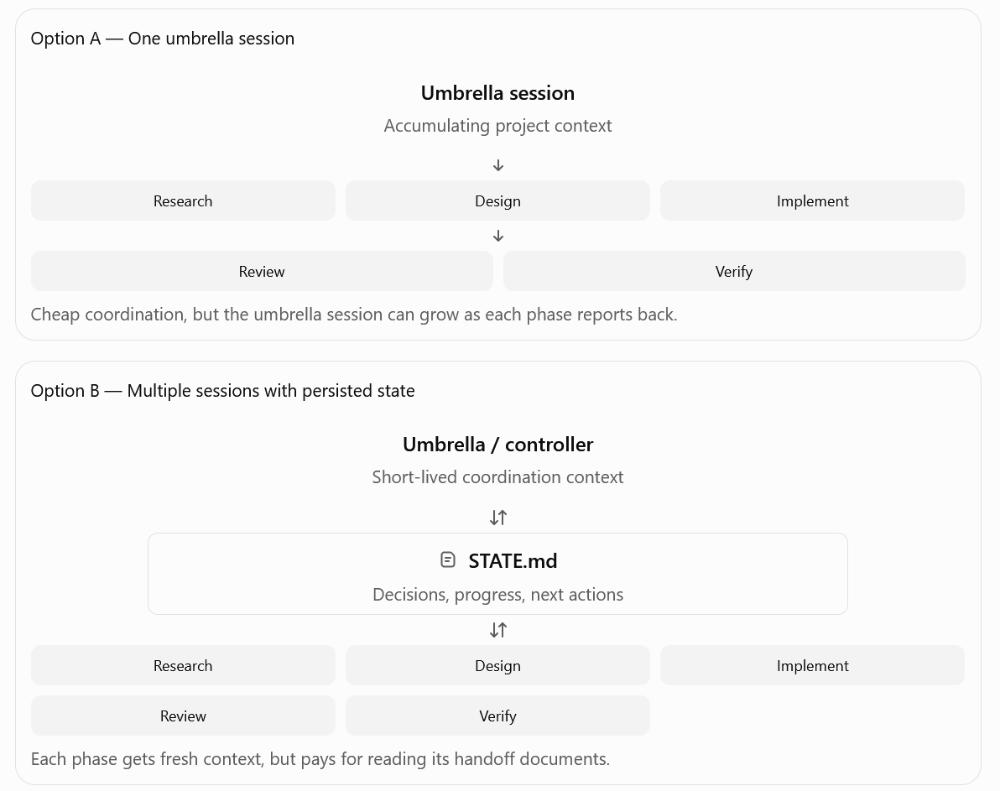
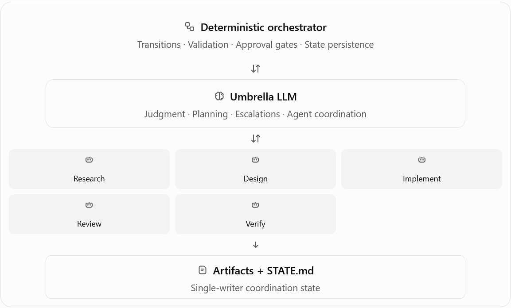
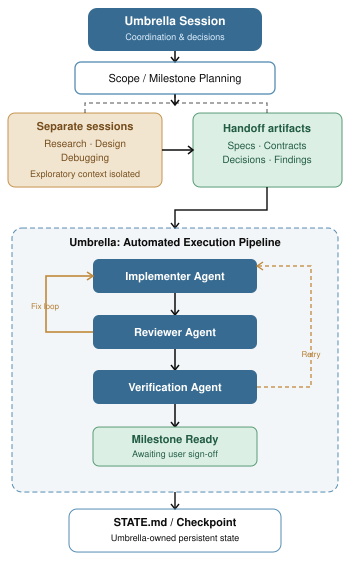

# On token efficiency vs coordination
For token efficiency, I'd lean toward multiple scoped sessions coordinated through `STATE.md` for your Artifex workflow, especially for long-running projects. But for short, contained workflows, a single umbrella session spawning subagents is probably cheaper.

The distinction is context lifecycle, not simply the number of agents.

## Comparing the two

| Factor                           | One session + subagents      | Multiple sessions + `STATE.md` |
| -------------------------------- | ---------------------------- | ------------------------------ |
| Initial token overhead           | Lower                        | Higher                         |
| Context isolation                | Good                         | Excellent                      |
| Repeated handoffs                | Usually cheaper              | Requires rereading state       |
| Long-running projects            | Accumulates umbrella context | Can reset sessions             |
| Resuming after days              | Depends on session history   | Explicit persisted state       |
| Coordination overhead            | Lower                        | Higher                         |
| Token consumption predictability | Moderate                     | Potentially better             |
| Parallel execution               | Supported                    | Supported, with orchestration  |

Both approaches already give worker agents independent contexts. Subagents don't inherit the entire parent conversation by default, depending on the harness.So separate sessions don't inherently save worker tokens.

## Where the difference actually comes from
Consider your Artifex pipeline:



## An illustrative token calculation
Suppose the umbrella accumulates 8k tokens of relevant history per phase. A `STATE.md` handoff instead takes 2k tokens per phase.

For five sequential phases, counting only the coordination context read on one model call per phase:


This example deliberately exaggerates the gap to illustrate the mechanism. Actual costs depend on how much history is retained, context compaction, prompt caching, handoff size, and the number of model calls.

**The catch**: In multi-session workflows, agents might repeatedly rediscover information that another agent already understood. That can erase any savings from smaller contexts.

## What I'd choose for Artifex

A hybrid, with persistent artifacts and disposable execution contexts.

- Keep one umbrella session per milestone, rather than one for the entire project.
- Spawn subagents for bounded, parallel work within that milestone.
- Persist decisions, implementation handoffs, review findings, and verification results in files.
- Start a new umbrella session at milestone boundaries, loading only relevant artifacts and `STATE.md`.
- Avoid having every agent rewrite the central state file. Give the umbrella responsibility for consolidating state.

This keeps the cheaper coordination of subagents without making one umbrella conversation carry the entire project's history.

> For Artifex, a little redundant context exchange is preferable to introducing shared-state concurrency and consistency risks.

It's also consistent with current guidance from OpenAI and Anthropic: subagents provide context isolation but add token overhead; independent sessions become useful when work outlives a single context window or needs persistent coordination.

## One important distinction

If your objective is minimum total tokens, the answer isn't established by a direct benchmark comparing these exact architectures.

If your objective is stable token consumption across a long-running software project, I'd favor the hybrid architecture above.

And I wouldn't build sophisticated state management yet. A small `STATE.md` plus your existing Artifex artifacts should be sufficient to test the approach.

The most interesting metric isn't tokens per session. It's total tokens per successfully verified milestone, including retries, rediscovery, review loops, and rework. That's where a seemingly cheaper architecture can become surprisingly expensive.

## More deterministic orchestrator
We can make orchestration deterministic without eliminating the umbrella's coordination role.

I'd revise the architecture to:

- Script = execution control. Determines which agent runs, enforces phase transitions, checks required artifacts, handles retries, and manages approval gates.
- Umbrella = decision-making. Interprets results, resolves ambiguity, handles escalations, and decides whether a change requires revisiting the design.
- Subagents = scoped execution. Research, design, implementation, review, and verification. They report their results through the umbrella rather than independently modifying shared coordination state.
- `STATE.md` = checkpoint. Written by one owner, recording decisions, progress, and outstanding work. It's not an inter-agent message bus.

The resulting flow would look like this:



One adjustment I'd make: the umbrella shouldn't have to interpret routine success or failure if the script can determine it reliably. Agents could return structured results such as `completed`, `blocked`, `needs_decision`, or `changes_requested`. The script validates these against expected artifacts and routes accordingly. Anything requiring judgment goes to the umbrella.

That keeps control deterministic while avoiding the mistake of treating an agent's self-reported success as proof of correctness.

It also lets you retain the subagent handoff model you're already developing, without immediately committing to complex multi-session shared-state coordination.

The remaining question for token efficiency is whether the umbrella should persist across the entire milestone or be re-created from checkpoints between phases. That's a separate optimization we can evaluate without changing the underlying architecture.

## Latest hybrid approach
You're already using a hybrid architecture, with session boundaries based on the nature of the work.

- Research / Design / Debugging: Separate sessions for exploratory, context-heavy work.
- Implementation → Review → Verification: Automated subagent pipeline spawned within the umbrella session, using explicit handoffs.
- Umbrella: Coordinates execution, receives results, handles exceptions, and maintains workflow state.


I actually think this is a sensible split for token efficiency.

Research and debugging tend to accumulate substantial exploratory context, much of which becomes irrelevant once a conclusion is reached. Isolating them prevents that history from bloating the umbrella.

Implementation, review, and verification, meanwhile, benefit from tight feedback loops. Keeping them under one umbrella reduces the overhead of repeatedly reconstructing coordination context across independent sessions.

The optimization I'd focus on now is the umbrella's involvement in the automated loop, not further session separation.

For example, instead of:

`Implementer → Umbrella interprets → Reviewer → Umbrella interprets → Implementer`

You could eventually have a deterministic script handle routine transitions, while the umbrella receives concise checkpoints or exceptions.

That preserves your existing agent boundaries and handoff contracts without introducing shared-state coordination risks.

One caveat: subagent isolation doesn't automatically mean token efficiency. If implementation and review agents repeatedly reread large artifacts or codebase context, that cost may dominate the relatively small umbrella overhead.

So I wouldn't restructure your current setup purely to reduce tokens. Your existing separation already targets the most obvious source of context waste: exploratory work leaking into execution.

The next worthwhile improvement is probably making your automated execution loop more deterministic, exactly as you suggested—not adding more independent sessions.

## Umbrella manual coordination vs script
The difference is who decides what happens next: the umbrella LLM or deterministic code.

In normal umbrella–subagent coordination, the umbrella interprets each agent's response and decides the next action, even when the transition is obvious.

### 1. Normal umbrella–subagent coordination

```
Umbrella LLM
  ├─ Spawn Implementer
  ├─ Read implementation result
  ├─ Decide to spawn Reviewer
  ├─ Read review result
  ├─ Decide whether to retry
  ├─ Spawn Implementer again
  ├─ Read result
  ├─ Spawn Verification Agent
  └─ Interpret verification result
```

Every transition involves another umbrella inference. That consumes tokens, even for decisions that follow fixed rules.

### 2. Script-driven coordination

```
Umbrella LLM
  │
  ▼
Orchestration Script
  ├─ Spawn Implementer
  ├─ Check completion status
  ├─ Spawn Reviewer
  ├─ If changes_requested → retry Implementer
  ├─ If approved → spawn Verifier
  ├─ If verification failed → retry or escalate
  └─ Report final result to Umbrella
                          │
                          ▼
                    Umbrella LLM
                    Handles exceptions
```

Here, the script handles predictable transitions without invoking the umbrella LLM.

## The practical difference

|                                | Normal umbrella             | Script-driven                |
| ------------------------------ | --------------------------- | ---------------------------- |
| Who spawns subagents?          | Umbrella LLM                | Script                       |
| Who decides retries?           | Umbrella LLM                | Script, within defined rules |
| Who evaluates review feedback? | Umbrella LLM                | Reviewer agent               |
| Who decides design changes?    | Umbrella LLM                | Umbrella LLM                 |
| Umbrella context growth        | Every agent response        | Checkpoints and exceptions   |
| Token overhead                 | Repeated coordination calls | Fewer coordination calls     |

### But there's a catch for Artifex

Your current workflow already uses handoff contracts and automated agent execution.

If your umbrella is simply calling agents based on clearly defined rules, the difference may be fairly small.

The script would primarily eliminate the umbrella's intermediate reasoning calls. It wouldn't eliminate tokens spent by implementers, reviewers, or verifiers.

And if your existing agent framework already supports programmatic chaining, retries, and conditional execution, adding another orchestrator could be redundant.

So I'd only introduce scripted orchestration if the umbrella is currently spending significant context and tokens on repetitive coordination.

Otherwise, you're trading a relatively small token optimization for additional code, integration, and maintenance complexity.
